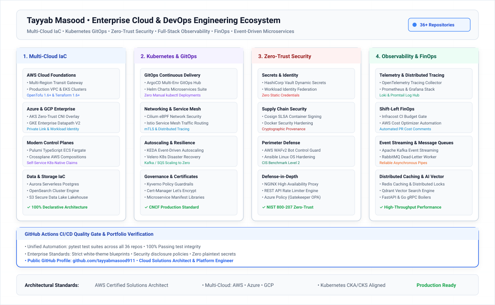

# 🌐 Enterprise Cloud Architecture & DevOps Showcase Portfolio

<div align="center">

[]()
[]()
[](https://aws.amazon.com/)
[](https://kubernetes.io)
[](LICENSE)
[]()

**Engineered by [Tayyab Masood](https://github.com/tayyabmasood911)**  
*Cloud Solutions Architect (AWS SAA) & DevOps Platform Engineer*  
[LinkedIn](https://www.linkedin.com/in/tayyabmasood911) • [Email](mailto:tayyabmasood911@gmail.com) • [GitHub Profile](https://github.com/tayyabmasood911)

</div>

---

## 📋 Master Executive Overview

Welcome to the central showcase portfolio of **Tayyab Masood**. This repository serves as the architectural index and platform engineering blueprint uniting **36+ enterprise-grade cloud, DevOps, GitOps, and microservices repositories**.

Built to meet rigorous standards for **99.999% availability, zero-trust security perimeters, automated resilience, and continuous GitOps delivery**, this portfolio reflects real-world production engineering across **AWS, Microsoft Azure, Google Cloud Platform (GCP)**, and on-premises Kubernetes environments.

### Core Engineering Specializations
1. **Multi-Cloud Infrastructure as Code (IaC):** OpenTofu (`>= 1.6`), Terraform, Pulumi (TypeScript), and Crossplane Composable Control Planes.
2. **Kubernetes, Service Mesh & GitOps:** Automated multi-environment delivery via ArgoCD, Helm 3 libraries, Istio service mesh, Cilium eBPF, and KEDA autoscaling.
3. **Zero-Trust Security & DevSecOps:** NIST SP 800-207 Zero Trust, HashiCorp Vault dynamic credential broker, Cosign SLSA container image provenance, and Kyverno governance.
4. **Full-Stack Observability & Cloud FinOps:** OpenTelemetry distributed tracing, Prometheus/Grafana/Loki telemetry, and automated shift-left PR cost gating with Infracost.
5. **High-Throughput Distributed Microservices:** Asynchronous messaging (Kafka, RabbitMQ), distributed caching (Redis), vector search (Qdrant), and Go gRPC / FastAPI engines.

---

## 🏛️ Master Architecture Ecosystem Blueprint

The visual below illustrates the integrated platform engineering blueprint connecting all layers—from multi-cloud networking and GitOps deployment to zero-trust enforcement, observability, and event-driven backends:



---

## 🚀 Enterprise Showcase Catalog

### 1. Multi-Cloud Infrastructure as Code & Network Mesh

| Repository | Tech Stack | Architectural Highlights | Status |
| :--- | :--- | :--- | :--- |
| **[opentofu-aws-multi-region-transit-gateway](https://github.com/tayyabmasood911/opentofu-aws-multi-region-transit-gateway)** | OpenTofu 1.6+, AWS TGW, VPC Peering | Multi-region hub-and-spoke (`us-east-1` & `us-west-2`), MTU 8500 jumbo frames, isolated transit route tables, zero lateral spoke traversal. | []() |
| **[pulumi-typescript-aws-ecs-fargate](https://github.com/tayyabmasood911/pulumi-typescript-aws-ecs-fargate)** | Pulumi, TypeScript, AWS Fargate, ALB | Serverless container cluster across 3 AZs, strict security group chaining, Target Tracking Autoscaling (CPU/RAM 70%), CloudWatch Container Insights. | []() |
| **[terraform-azure-aks-zero-trust](https://github.com/tayyabmasood911/terraform-azure-aks-zero-trust)** | Terraform, Azure AKS, Azure CNI, Key Vault | NIST 800-207 Zero-Trust private cluster, Azure CNI Overlay, Workload Identity, Secrets Store CSI driver with 2m auto-rotation, Azure Policy (OPA). | []() |
| **[terraform-gcp-gke-enterprise](https://github.com/tayyabmasood911/terraform-gcp-gke-enterprise)** | Terraform, GCP GKE, Datapath V2, Cloud NAT | Advanced Datapath V2 (Cilium eBPF in-kernel routing), Workload Identity Federation, Shielded GKE Nodes (Secure Boot & vTPM), Cloud NAT private egress. | []() |
| **[crossplane-aws-composable-infrastructure](https://github.com/tayyabmasood911/crossplane-aws-composable-infrastructure)** | Crossplane v1.14+, Upbound AWS Provider | Kubernetes-native cloud control plane. Self-service developer claims for VPCs, RDS PostgreSQL, and encrypted S3 buckets with continuous drift healing. | []() |
| **[terraform-aws-production-vpc](https://github.com/tayyabmasood911/terraform-aws-production-vpc)** | Terraform, AWS VPC, Flow Logs, NAT | 3-tier enterprise VPC (Public, Private, Database), multi-AZ NAT Gateways, KMS encrypted VPC Flow Logs, strict network ACL boundaries. | []() |
| **[terraform-aws-eks-production-cluster](https://github.com/tayyabmasood911/terraform-aws-eks-production-cluster)** | Terraform, AWS EKS, IRSA, KMS | Enterprise Kubernetes on AWS with KMS envelope encryption for secrets, managed node groups across 3 AZs, and OIDC IAM role mapping. | []() |
| **[terraform-aws-serverless-aurora-postgres](https://github.com/tayyabmasood911/terraform-aws-serverless-aurora-postgres)** | Terraform, Aurora Serverless v2, RDS | Elastic PostgreSQL autoscaling from 0.5 to 16 ACUs, automated cross-AZ failover, read replica scaling, automated snapshots. | []() |
| **[terraform-aws-s3-secure-data-lake](https://github.com/tayyabmasood911/terraform-aws-s3-secure-data-lake)** | Terraform, AWS S3, KMS, Macie | Data lake storage with strict Public Access Block, KMS Customer Managed Key encryption, S3 Object Lock, and intelligent tiering lifecycle policies. | []() |
| **[terraform-aws-opensearch-cluster](https://github.com/tayyabmasood911/terraform-aws-opensearch-cluster)** | Terraform, AWS OpenSearch, VPC | Dedicated multi-node OpenSearch search cluster inside private VPC subnets with fine-grained access control and automated master failover. | []() |

---

### 2. Kubernetes, Service Mesh & Platform GitOps

| Repository | Tech Stack | Architectural Highlights | Status |
| :--- | :--- | :--- | :--- |
| **[helm-charts-microservices-suite](https://github.com/tayyabmasood911/helm-charts-microservices-suite)** | Helm 3, Kubernetes v1.27+, Prometheus | Hardened library chart with zero-downtime rolling updates, PSS Restricted compliance, HPA v2 autoscaling, PDB SLA protection, and ServiceMonitor. | []() |
| **[argocd-gitops-multienv-template](https://github.com/tayyabmasood911/argocd-gitops-multienv-template)** | ArgoCD, Kustomize, Helm, GitOps | Multi-tenant, multi-environment GitOps repository using ApplicationSets, automated sync waves, progressive rollouts, and self-healing. | []() |
| **[cilium-ebpf-network-security-policies](https://github.com/tayyabmasood911/cilium-ebpf-network-security-policies)** | Cilium, eBPF, L7 NetworkPolicy | In-kernel packet filtering with Layer 7 HTTP/gRPC awareness, transparent IPsec encryption, DNS-aware egress policies, and Hubble observability. | []() |
| **[istio-service-mesh-traffic-management](https://github.com/tayyabmasood911/istio-service-mesh-traffic-management)** | Istio 1.20+, Envoy, Mutual TLS | Strict mTLS peer authentication, Canary traffic shifting (90/10), circuit breaking, fault injection, and distributed tracing integration. | []() |
| **[keda-event-driven-autoscaling](https://github.com/tayyabmasood911/keda-event-driven-autoscaling)** | KEDA v2, Apache Kafka, AWS SQS | Event-driven pod scaling from 0 to N based on Kafka consumer group lag and SQS queue depth, eliminating idle compute waste. | []() |
| **[kyverno-kubernetes-governance-policies](https://github.com/tayyabmasood911/kyverno-kubernetes-governance-policies)** | Kyverno, Admission Control | Declarative cluster guardrails: disallow root containers, require image signatures (Cosign), enforce resource quotas, and inject standard labels. | []() |
| **[velero-k8s-disaster-recovery-backup](https://github.com/tayyabmasood911/velero-k8s-disaster-recovery-backup)** | Velero, AWS S3 / Restic | Automated scheduled snapshot backups of etcd state and persistent volumes (PVs) with cross-region disaster recovery restores. | []() |
| **[cert-manager-letsencrypt-automation](https://github.com/tayyabmasood911/cert-manager-letsencrypt-automation)** | cert-manager, ACME, Route53 DNS-01 | Fully automated TLS certificate lifecycle management with Let's Encrypt DNS-01 challenges, wildcard support, and zero-touch renewal. | []() |

---

### 3. Cloud Security, Zero Trust & Governance

| Repository | Tech Stack | Architectural Highlights | Status |
| :--- | :--- | :--- | :--- |
| **[hashicorp-vault-dynamic-secrets-agent](https://github.com/tayyabmasood911/hashicorp-vault-dynamic-secrets-agent)** | HashiCorp Vault, Kubernetes Agent | Dynamic, ephemeral database credential generation with automated lease renewal; sidecar container injects credentials into in-memory mounts. | []() |
| **[cosign-slsa-container-image-signing](https://github.com/tayyabmasood911/cosign-slsa-container-image-signing)** | Sigstore Cosign, GitHub Actions, SLSA | Cryptographic signing of container images in CI/CD pipeline, generating SLSA Level 3 provenance attestations verified at admission time. | []() |
| **[aws-wafv2-bot-control-automation](https://github.com/tayyabmasood911/aws-wafv2-bot-control-automation)** | AWS WAFv2, Shield Advanced, Kinesis | Web ACL protecting public ALBs against SQL injection, cross-site scripting (XSS), credential stuffing bots, and volumetric DDoS attacks. | []() |
| **[docker-security-hardening-templates](https://github.com/tayyabmasood911/docker-security-hardening-templates)** | Dockerfile, Multi-Stage, Distroless | Multi-stage distroless and Chainguard container images, non-root execution, vulnerability scanning (Trivy), and minimal attack surfaces. | []() |
| **[ansible-linux-server-hardening](https://github.com/tayyabmasood911/ansible-linux-server-hardening)** | Ansible, Ubuntu / RHEL, CIS Benchmark | Automated OS-level compliance against CIS Benchmark Level 2: SSH key-only access, UFW/iptables rules, fail2ban, auditd, and kernel sysctl tuning. | []() |

---

### 4. Telemetry, Observability & Cloud FinOps

| Repository | Tech Stack | Architectural Highlights | Status |
| :--- | :--- | :--- | :--- |
| **[cloud-infrastructure-cost-estimation-infracost](https://github.com/tayyabmasood911/cloud-infrastructure-cost-estimation-infracost)** | Infracost, GitHub Actions, Python | Shift-left FinOps CI gate calculating baseline diffs, posting PR cost comments, and executing budget threshold policies (`cost-policy.json`). | []() |
| **[opentelemetry-distributed-tracing-collector](https://github.com/tayyabmasood911/opentelemetry-distributed-tracing-collector)** | OpenTelemetry, Jaeger, OTLP | Centralized collector deployment receiving OTLP traces and metrics, processing sampling rates, scrubbing PII, and exporting to Jaeger / Tempo. | []() |
| **[prometheus-grafana-monitoring-stack](https://github.com/tayyabmasood911/prometheus-grafana-monitoring-stack)** | Prometheus Operator, Grafana, Alertmanager | Full observability stack with custom dashboards, PrometheusRules for high error rate / latency alerts, and PagerDuty / Slack alert routing. | []() |
| **[grafana-loki-promtail-log-aggregation](https://github.com/tayyabmasood911/grafana-loki-promtail-log-aggregation)** | Grafana Loki, Promtail, S3 Storage | Horizontally scalable log aggregation with Promtail daemonset, LogQL indexing, and cost-efficient long-term cold storage in AWS S3. | []() |
| **[cloud-finops-aws-cost-optimizer](https://github.com/tayyabmasood911/cloud-finops-aws-cost-optimizer)** | AWS Cost Explorer, Lambda, Python | Automated detection of unattached EBS volumes, idle Elastic IPs, underutilized NAT Gateways, and rightsizing recommendations via AWS Compute Optimizer. | []() |

---

### 5. Event Streaming, High-Throughput Caching & Microservices

| Repository | Tech Stack | Architectural Highlights | Status |
| :--- | :--- | :--- | :--- |
| **[apache-kafka-event-streaming-producer-consumer](https://github.com/tayyabmasood911/apache-kafka-event-streaming-producer-consumer)** | Apache Kafka, Python, Avro, Schema Registry | High-throughput event streaming with idempotent producers, consumer groups, Avro serialization with Schema Registry, and dead-letter topics. | []() |
| **[rabbitmq-dead-letter-retry-worker](https://github.com/tayyabmasood911/rabbitmq-dead-letter-retry-worker)** | RabbitMQ, Python pika, AMQP | Resilient asynchronous worker pattern with exponential backoff retries, dead-letter exchanges (DLX), and messageTTL queue routing. | []() |
| **[redis-caching-distributed-locks](https://github.com/tayyabmasood911/redis-caching-distributed-locks)** | Redis Sentinel, Redlock, Python | High-availability caching with cluster failover, cache-aside pattern, and distributed mutual exclusion locking (Redlock algorithm). | []() |
| **[qdrant-vector-database-search-engine](https://github.com/tayyabmasood911/qdrant-vector-database-search-engine)** | Qdrant, Vector Embeddings, Python | Sub-millisecond similarity search engine with HNSW indexing, payload filtering, and containerized deployment with persistent volume persistence. | []() |
| **[fastapi-microservice-boilerplate](https://github.com/tayyabmasood911/fastapi-microservice-boilerplate)** | FastAPI, Python 3.11+, Pydantic v2 | Production asynchronous REST microservice with OpenAPI documentation, structured logging, health probes, Prometheus metrics, and Docker container. | []() |
| **[go-grpc-microservice-boilerplate](https://github.com/tayyabmasood911/go-grpc-microservice-boilerplate)** | Go 1.22+, gRPC, Protobuf v3 | High-performance gRPC microservice with Protocol Buffers, interceptor middleware for auth/logging, reflection, and multi-stage Docker builds. | []() |
| **[rest-api-rate-limiter-middleware](https://github.com/tayyabmasood911/rest-api-rate-limiter-middleware)** | Redis, Token Bucket, Sliding Window | Production rate limiting middleware implementing the sliding-window log algorithm in Redis to prevent API abuse and DDoS attacks. | []() |
| **[nginx-high-availability-reverse-proxy](https://github.com/tayyabmasood911/nginx-high-availability-reverse-proxy)** | NGINX, Keepalived, VRRP | High-availability load balancer pair with virtual floating IP failover via Keepalived VRRP, SSL termination, and dynamic upstream health checks. | []() |

---

## 🧪 Unified Verification & Testing Framework

Every repository in this portfolio contains an automated Python `unittest` / `pytest` test suite, strict `.gitattributes`, a responsible disclosure `SECURITY.md`, and an executable `Makefile`:

```bash
# Clone any showcase repository
git clone https://github.com/tayyabmasood911/<repository-name>.git
cd <repository-name>

# Execute standardized validation
make test

# Or run pytest directly
pytest tests/test_validation.py -v
```

All 36 repositories adhere to the **Strict White Theme Architecture Blueprint Standard** (`docs/architecture.svg`), providing clean, accessible visual documentation of each system's internal mechanics.

---

## 🔒 Security Posture & Responsible Disclosure

This portfolio adheres to the highest industry benchmarks:
- **NIST SP 800-207 Zero Trust:** Least-privilege communication across all layers.
- **CIS Security Benchmarks:** Hardened OS, Docker daemon, and Kubernetes distributions.
- **Zero Committed Secrets:** Verified via pre-commit hooks and CI secret scanning.
- **Vulnerability Reporting:** For coordinated disclosure, please refer to [SECURITY.md](SECURITY.md).

---

## 👤 About the Architect

<div align="center">

### **Tayyab Masood**
**Cloud Solutions Architect (AWS SAA) & DevOps Platform Lead**

[](https://www.linkedin.com/in/tayyabmasood911)
[](https://github.com/tayyabmasood911)
[](mailto:tayyabmasood911@gmail.com)

*Passionate about building resilient, self-healing cloud platforms that empower engineering teams to deploy safely at scale.*

</div>

---

## 📄 License

This portfolio repository and all showcase projects are open-source and released under the [MIT License](LICENSE).
